

  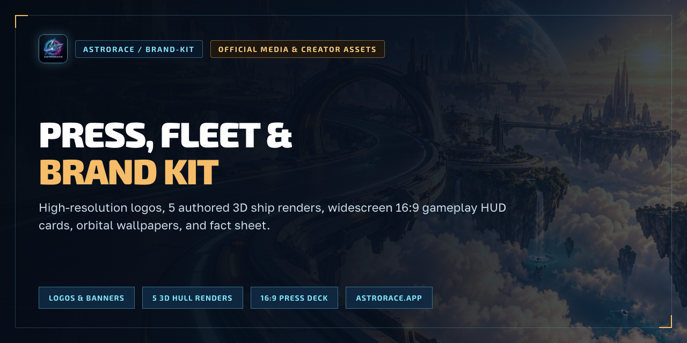

# ASTRORACE — Official Brand, Media & Creator Kit

Official visual assets, 3D fleet renders, widescreen gameplay cards, and brand typography/color tokens for media, research platforms, tournament organizers, and ecosystem partners.

- **Website:** [https://astrorace.app](https://astrorace.app)
- **Playable Build:** [https://play.astrorace.app](https://play.astrorace.app)
- **Documentation:** [https://astrorace.app/docs/](https://astrorace.app/docs/)
- **Official X:** [https://x.com/astroracegame](https://x.com/astroracegame)
- **Media Inquiries:** `press@astrorace.app`

---

## 1. Official Square Emblem (`1024×1024`) & Key Art Banners

| Square App / Listing Icon (`1024×1024`) | Key Art Hero Cover (`1920×1080`) |
| :---: | :---: |
| 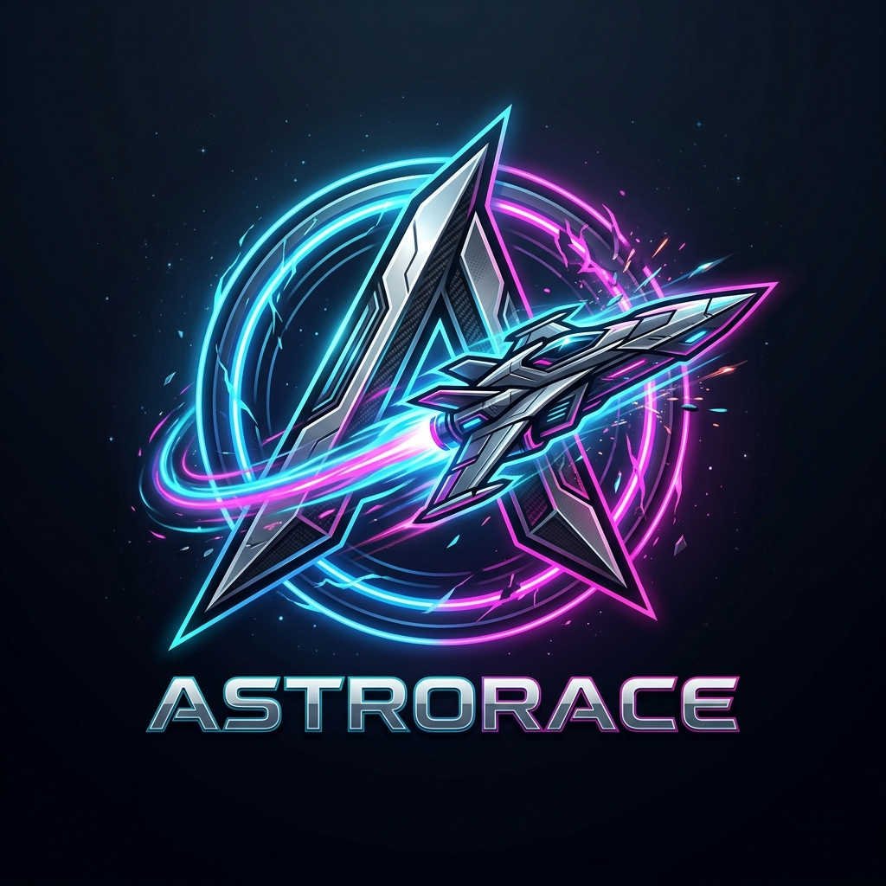 | 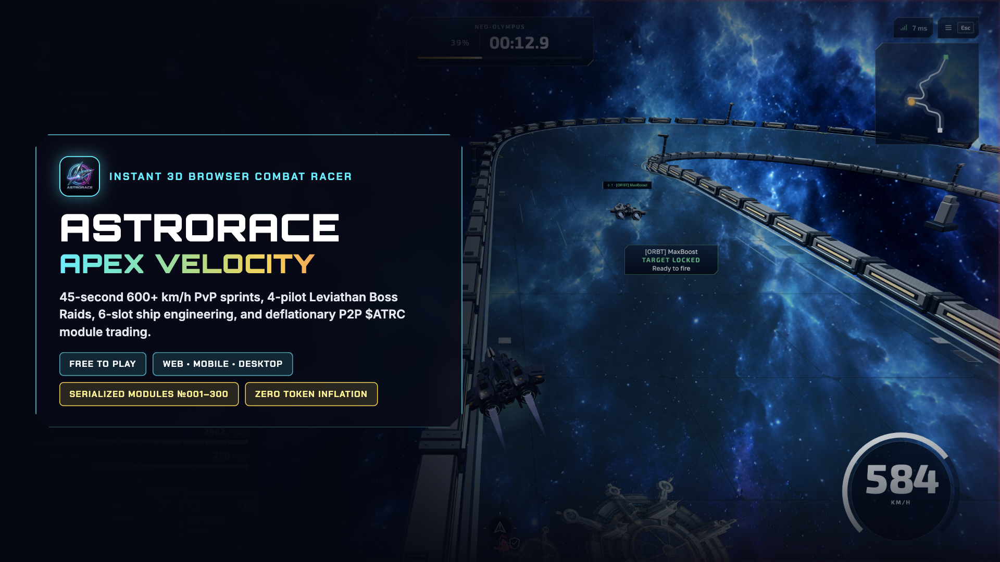 |

---

## 2. Five Authored 3D Ship Hull Renders (`PNG`)

| Solar | Heavy | Vanguard | Neon | Aero |
| :---: | :---: | :---: | :---: | :---: |
| 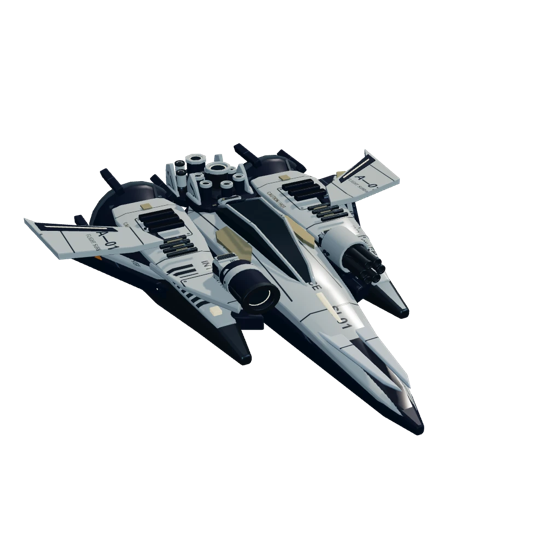 | 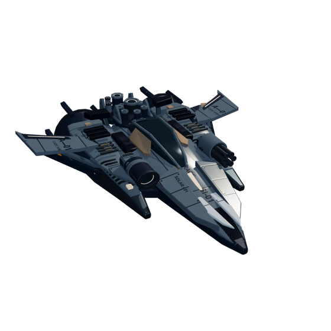 | 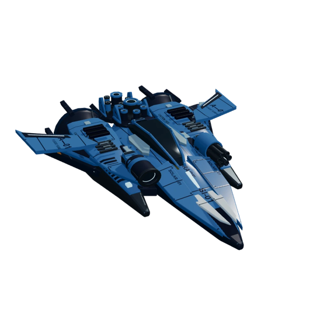 | 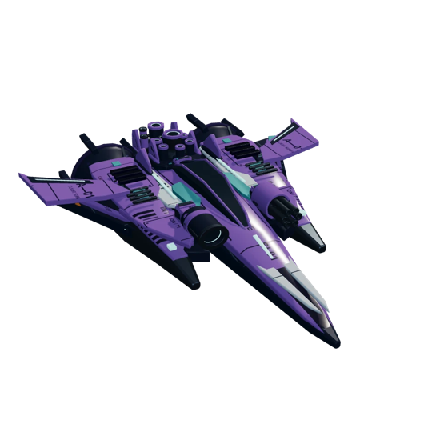 | 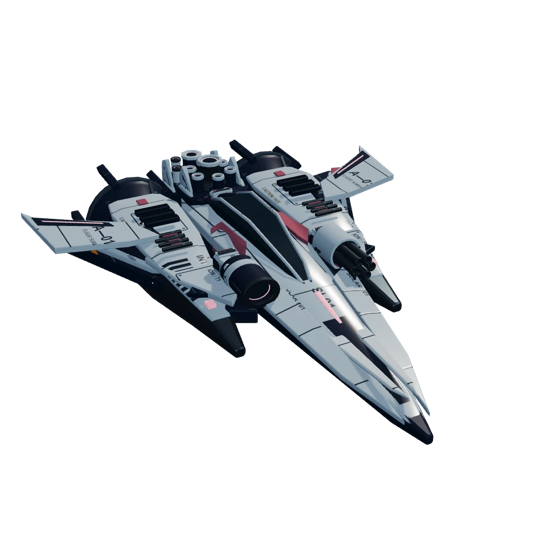 |

---

## 3. Widescreen `16:9` Feature & Gameplay Press Deck

<table>
  <tr>
    <td width="50%">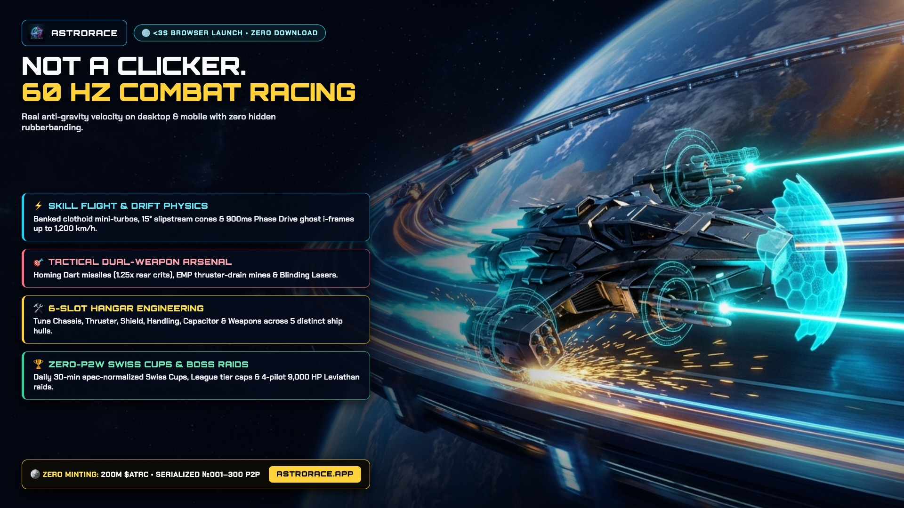</td>
    <td width="50%">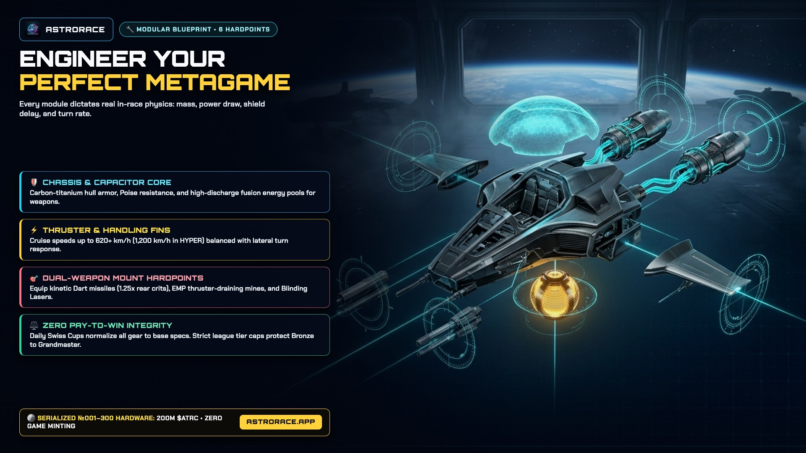</td>
  </tr>
  <tr>
    <td width="50%">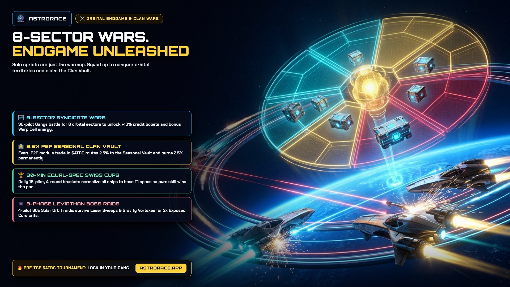</td>
    <td width="50%">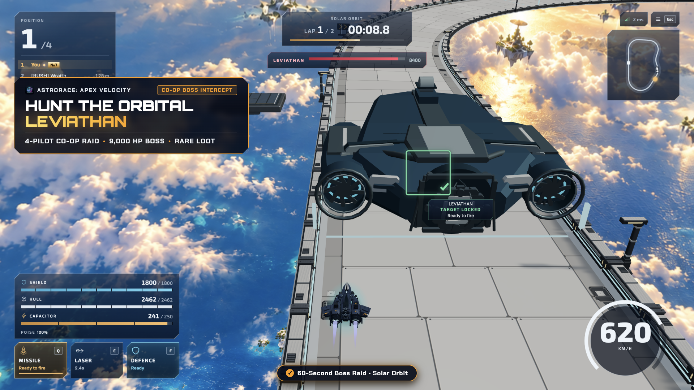</td>
  </tr>
</table>

---

## 4. Canonical Color Palette & Typography

| Token | Hex | Usage |
| :--- | :--- | :--- |
| **Deep Void Obsidian** | `#070F1C` | Primary background surface |
| **Smoked Orbital Glass** | `#102B46` | Elevated HUD panels & data cards |
| **Hyperdrive Cyan** | `#87EAFF` | Primary accent, telemetry & active focus |
| **Ceres Champagne Gold** | `#F5BD69` | Championship badges, `$ATRC` accents & serials |
| **Display & Body Fonts** | `Exo 2` / `Golos Text` | Geometric display headers & tabular UI copy |
